## Hi, I'm Dylan 👋

I'm an AI Automation Specialist at Sydney Piling. I work out which back-office jobs are worth handing to an agent, build it, test it, then run it day to day. So far that's around 25 hours of admin a week.

Outside work I build AI, ML and data projects in public - mostly evals and experiments that answer one question properly. I'm studying IT (Business & Data Analytics) and Creative Intelligence and Innovation at UTS.

## Things I've built

| Project | What it is | The finding |
|---|---|---|
| [agent-cursor](https://github.com/dylannnnn111/agent-cursor) | VS Code extension that shows where your coding agents are working, live | Hooks into 9 agents (Claude Code tested live) |
| [tiny-agent](https://github.com/dylannnnn111/tiny-agent) | A coding agent in ~300 lines of TypeScript + a 40-task benchmark | 1,120 runs: no harness feature moved the pass rate |
| [judge-reliability](https://github.com/dylannnnn111/judge-reliability) | How far can you trust an LLM to grade other LLMs? | Rubric prompts beat plain for every judge. Opus favours its own answers |
| [aussie-data-mcp](https://github.com/dylannnnn111/aussie-data-mcp) | MCP server giving Claude live ABS, RBA and Opal data (on npm) | 10 tools, daily health check |
| [tool-schema-study](https://github.com/dylannnnn111/tool-schema-study) | Which tool schema choices make models call tools correctly? | Terse descriptions: right arguments 100% → 89% |
| [metro-effect](https://github.com/dylannnnn111/metro-effect) | Did the new Sydney Metro change evening travel? Causal inference on Opal data | Chatswood + Macquarie Park +9.2%, CBD no change |
| [economy-monitor](https://github.com/dylannnnn111/economy-monitor) | ABS + RBA data with data contracts, dbt and a daily refresh | 9 sources, 30 data tests, opens an issue when one breaks |

Write-ups with charts at [dylanlewis.au/projects](https://dylanlewis.au/projects).

## Latest on dylanlewis.au

<!-- LATEST:START -->
- [Agent Cursor](https://dylanlewis.au/projects/agent-cursor) - A VS Code extension that shows where your coding agents are working, live: a marker on the line each one is on, edits that glow as they land, and a sidebar where every agent has its own look.
- [Who Judges the Judge](https://dylanlewis.au/projects/judge-reliability) - How far can you trust a model to mark other models? 120 hand-labelled pairs, three Claude judges, three prompt formats and 4,200 judge calls, measuring agreement plus position, length and self-preference bias.
- [Tiny Agent](https://dylanlewis.au/projects/tiny-agent) - A coding agent in about 300 lines of TypeScript with nothing hidden, then an ablation: a switch on every part of the harness, 40 tasks with hidden tests, and what each part turns out to be worth.
- [Gradient](https://dylanlewis.au/projects/gradient) - Backpropagation written from scratch in TypeScript, with a neural network you can watch learn in the browser.
<!-- LATEST:END -->

## What I use

## Find me

[dylanlewis.au](https://dylanlewis.au) · [LinkedIn](https://www.linkedin.com/in/dylan-lewis-67715136b/) · [npm](https://www.npmjs.com/package/aussie-data-mcp)
